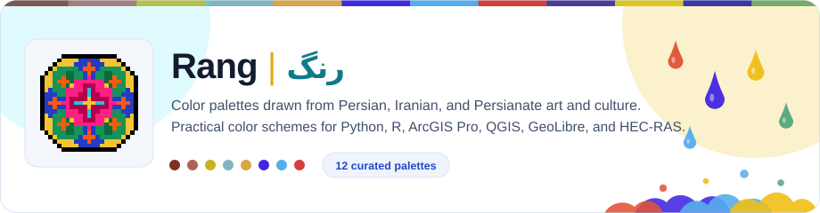
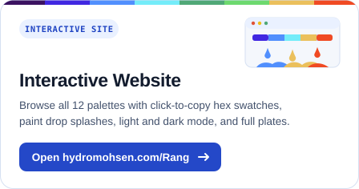
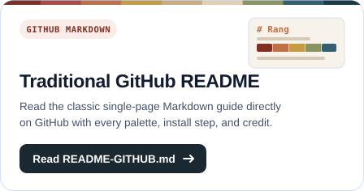
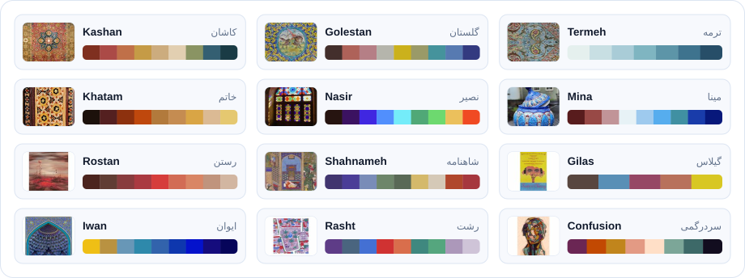

  <a href="https://hydromohsen.com/Rang/">
    <picture>
      <source media="(prefers-color-scheme: dark)" srcset="site/readme/hero-dark.svg">
      <source media="(prefers-color-scheme: light)" srcset="site/readme/hero-light.svg">
      
    </picture>
  </a>

<h3 align="center">Choose how you want to explore Rang</h3>

  <a href="https://hydromohsen.com/Rang/">
    <picture>
      <source media="(prefers-color-scheme: dark)" srcset="site/readme/card-website-dark.svg">
      <source media="(prefers-color-scheme: light)" srcset="site/readme/card-website-light.svg">
      
    </picture>
  </a>
  <a href="README-GITHUB.md">
    <picture>
      <source media="(prefers-color-scheme: dark)" srcset="site/readme/card-github-dark.svg">
      <source media="(prefers-color-scheme: light)" srcset="site/readme/card-github-light.svg">
      
    </picture>
  </a>

  <strong><a href="https://hydromohsen.com/Rang/">Open Interactive Website</a></strong>
  ·
  <strong><a href="README-GITHUB.md">Read Traditional GitHub README</a></strong>

  <a href="https://hydromohsen.com/Rang/#palettes">
    <picture>
      <source media="(prefers-color-scheme: dark)" srcset="site/readme/palette-strip-dark.svg">
      <source media="(prefers-color-scheme: light)" srcset="site/readme/palette-strip-light.svg">
      
    </picture>
  </a>

  Python · R · ArcGIS Pro · QGIS · GeoLibre · HEC-RAS

  <a href="https://hydromohsen.com/Rang/">Website</a> ·
  <a href="README-GITHUB.md">Traditional README</a> ·
  <a href="docs/language-and-scope.md">Language and Scope</a> ·
  <a href="examples/">Examples</a> ·
  <a href="CONTRIBUTING.md">Contribute</a> ·
  <a href="LICENSES/README.md">Licenses</a>

