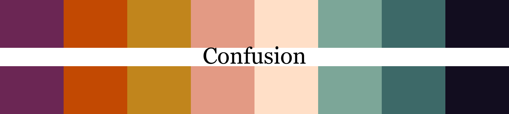
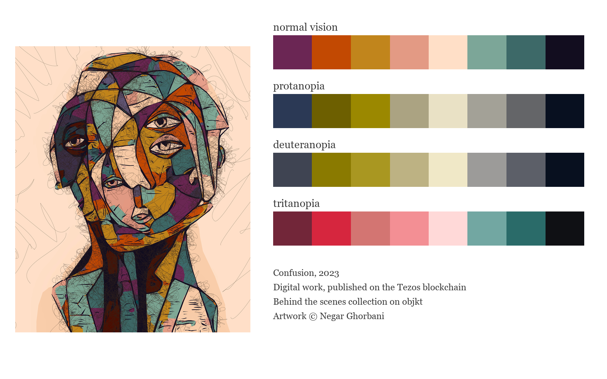
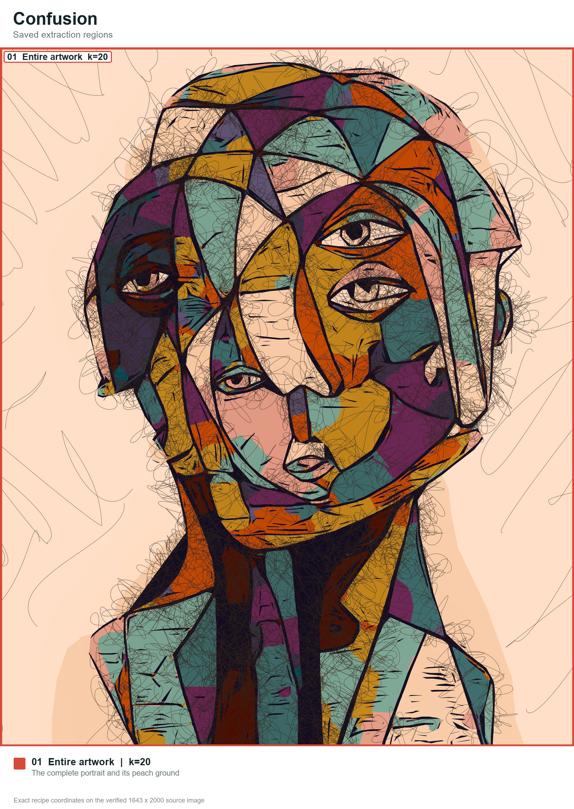
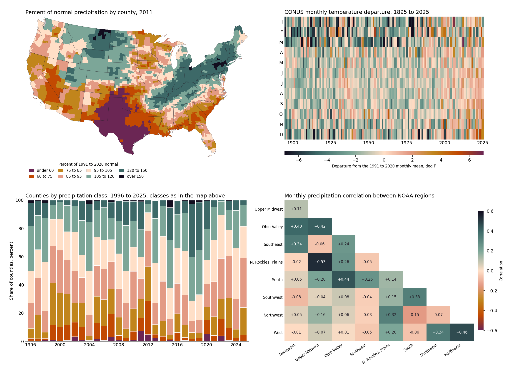

# Confusion (Persian: سردرگمی, say it kun-FYOO-zhun, sardargomi in Persian)



Confusion draws eight colors from Negar Ghorbani's 2023 digital portrait of the same name. Aubergine, rust, ochre, and dusty pink rise on one side toward the pale peach ground, and sage, teal, and ink fall away on the other. That shape suits data that departs from a normal value, such as precipitation or temperature anomalies.

## Source

Negar Ghorbani, Confusion, digital painting, minted December 2023.
Digital painting.
Behind the scenes collection on objkt.
Artwork © Negar Ghorbani.

[Token page on objkt](https://objkt.com/tokens/KT1NPL9BJ8YKg1Qumy9gHFrjUE1hWAx9fQ2h/14). Copyright Negar Ghorbani, all rights reserved. The source image and derived previews are included for this Rang contribution with permission obtained by the palette creator from the artist. No general license to reuse the artwork is granted here.

## The story

Ghorbani's portrait breaks one head into flat planes of color, with several faces and eyes sharing it and a fine scribbled line running over the whole figure. It was minted on the Tezos blockchain in December 2023 as part of her collection Behind the scenes. Her note with the work reads "I try to stay in a constant state of confusion just because of the expression it leaves on my face."

## Colors

| position | hex | drawn from | nearest sample |
|---|---|---|---|
| 1 | `#6b2654` | aubergine plum across the crown, jaw, and collar | 0.0 |
| 2 | `#c24902` | burnt rust around the eyes and along the jawline | 0.0 |
| 3 | `#c1851c` | ochre planes on the cheek and across the brow | 0.0 |
| 4 | `#e39a84` | dusty pink of the lower face and the shoulder edge | 0.2 |
| 5 | `#ffdfc7` | pale peach ground behind the figure | 0.0 |
| 6 | `#7ca698` | sage green of the jacket and the head panels | 0.8 |
| 7 | `#3d6968` | deep teal in the shadowed head panels and lapel | 0.0 |
| 8 | `#120d1f` | ink black of the outlines and the column of the neck | 0.0 |

The last column shows the CIEDE2000 distance to the closest sampled color in
the source photo. Lower numbers mean a closer match.

## The palette beside the artwork



## Extraction regions



These are the saved sampling areas used for CIELAB k-means. The exact pixel
coordinates, normalized coordinates and k values are recorded in the
[Confusion recipe](../../recipes/confusion.json). The regions make the
extraction repeatable. Choosing and refining the final colors still depends
on the artwork and the contributor's eye.

## Sample plots



All four panels use NOAA nClimDiv data, with U.S. Census boundaries for the
map. Normal is the 1991 to 2020 mean. The continuous panels stretch each side
of the lightest color so that zero lands on it. Connecticut uses its statewide
value because its 2023 planning regions do not match the county records.
Run `python tools/make_samples.py confusion` to remake them.

## Separation and color vision

| vision | min CIEDE2000 | mean |
|---|---|---|
| normal vision | 18.2 | 41.2 |
| protanopia | 8.6 | 35.3 |
| deuteranopia | 9.6 | 35.1 |
| tritanopia | 9.1 | 40.8 |

The lowest score is 8.6. Rang's cutoff is 8, so all pairwise scores are above it.

When you ask for fewer colors, the stored pick order spreads them out. Check the finished figure when color distinction matters.

## Use it

Python

```python
import rang

rang.rang("Confusion", 5)              # five well separated colors
rang.cmap("Confusion")                 # smooth matplotlib colormap
rang.cmap("Confusion", 6)              # six fixed steps for classified data

rang.register()                     # then use it anywhere by name
data.plot(cmap="rang:Confusion")
```

R

```r
library(Rang)
library(ggplot2)

rang("Confusion", 5)                   # five well separated colors

# categories
ggplot(df, aes(group, value, fill = group)) +
  geom_col() +
  scale_fill_rang_d("Confusion")

# a numeric variable
ggplot(df, aes(x, y, color = value)) +
  geom_point() +
  scale_color_rang_c("Confusion")
```

ArcGIS Pro users get every palette by importing
[arcgis/Rang.stylx](../../arcgis/Rang.stylx) once, with steps in the
[ArcGIS guide](../../arcgis/README.md). QGIS users can import
[qgis/Rang.xml](../../qgis/Rang.xml) for the ramps or
[qgis/Confusion.gpl](../../qgis/Confusion.gpl) for swatches, see the
[QGIS guide](../../qgis/README.md). HEC-RAS users can import
[hecras/Rang-Confusion.xml](../../hecras/Rang-Confusion.xml), see the
[HEC-RAS guide](../../hecras/README.md). GeoLibre users can copy colors from
[geolibre/Rang.txt](../../geolibre/Rang.txt), with steps for raster and vector
layers in the [GeoLibre guide](../../geolibre/README.md).
